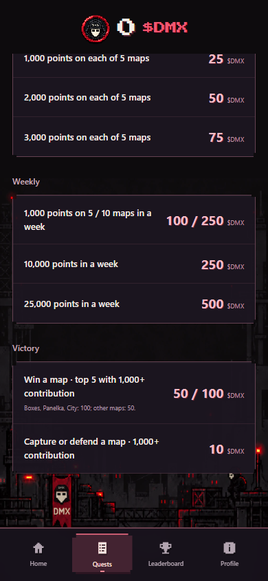
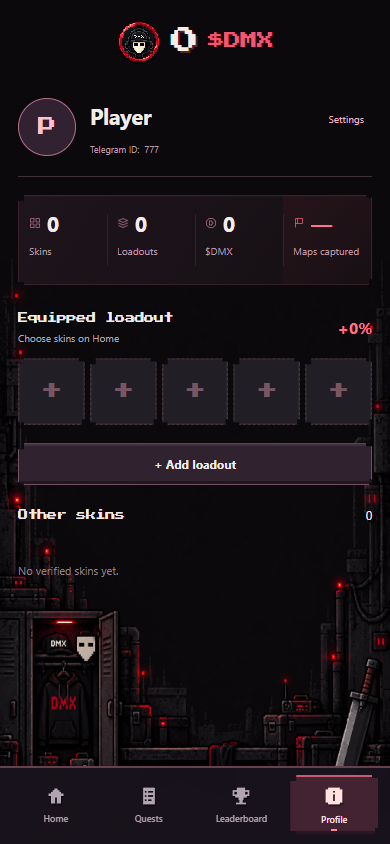
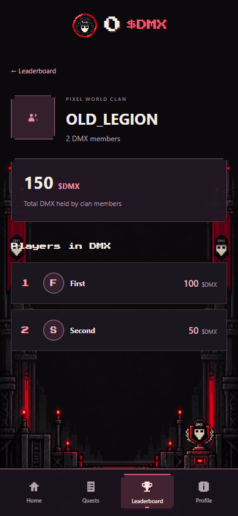
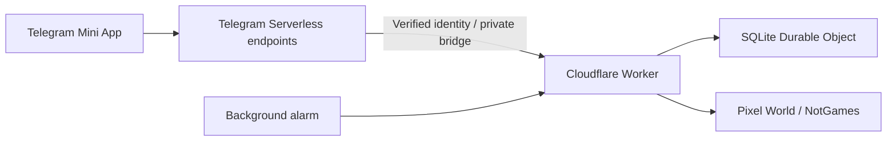

# DMX Arena

A live Telegram Mini App for Pixel World clan battles: verified game profiles, skin loadouts, quests, DMX rewards and player/clan rankings.

**Portfolio snapshot of the current released beta**, including the latest storage, clan balance and language fixes. The public repository contains the application and tests; live player records, Telegram sessions, bot tokens and deployment keys are excluded.

[Open the Telegram bot](https://t.me/DMXARENABOT)



## Implemented

- Pixel World UID linking and game-derived player names.
- Ownership-checked skin equipment, saved loadouts and a 3D character presentation.
- Active battle cards and previous/next map previews.
- Automatic map ladders, daily rotation quests and weekly milestones.
- One-time channel subscription and DMX nickname quests; completed/deferred cards move down.
- Set bonuses for repeatable game quests, with base rewards shown in the UI. One-time quests have fixed rewards.
- Player and clan rankings. A clan total is the sum of its current members' DMX balances.
- Public profiles, privacy settings and English/Russian localization.
- English fallback, Telegram language detection and a persistent manual language override.
- Localized `/start` welcome messages and Mini App buttons.
- JavaScript cloud connector, background observations and transactional SQLite storage.




## Architecture



| Directory / module | Purpose |
| --- | --- |
| `dist/` | Current UI, translations, character assets and catalog |
| `tgcloud/` | Verified Telegram endpoints, subscription receipts and welcome handler |
| `js-connector/src/` | JavaScript game connector, bridge authorization and SQLite storage |
| `js-connector/generated/` | Hosting adapter generated from the shared application modules |
| `server.mjs`, `*.mjs` | Shared application, economy, equipment and quest logic |
| `inventory_worker.py`, `notgames.py`, `pixel_game.py`, `public_game.py`, `clan_data.py` | Preserved Python fallback source |

The Python connector remains a recovery option. Production uses JavaScript. The generated adapter keeps the existing business rules rather than implementing a second economy.

## Storage and rewards

Storage version 2 separates profiles, links, rewards and progress into records. Large records are split into bounded Unicode-safe parts. Migration and action writes use transactions; unchanged records are not rewritten. This removes the old aggregate-row size bottleneck while preserving provider quotas and application resource limits.

Reward keys are idempotent. Only verified game observations count. Ambiguous score changes around a map transition are held pending rather than attributed to an unverified map. This limitation follows from the aggregate game data available to the connector.

## Local setup and checks

Requirements: **Node.js 24+**, npm, and Python 3 for the SQLite welcome-handler regression test.

```sh
npm ci
npm ci --prefix js-connector
npm test
npm test --prefix js-connector
```

Checks cover account isolation, ownership and equipment rules, economy, duplicate payouts, map timing, language selection, welcome deduplication, bridge validation, migration rollback, Unicode chunk boundaries and storage above 2 MB. Tests use synthetic data and temporary databases.

For the browser regression suite:

```sh
npx playwright install chromium
npm run qa:beta
```

The suite starts its own local static server and mocks API responses. No live accounts or keys are required. Set `PLAYWRIGHT_CHANNEL=chrome` only if testing with an installed Google Chrome browser.

## Deployment

This source snapshot references the public bot/channel and current service endpoints for context. These are not deployment credentials. Deploy a separate instance using your own Telegram Serverless project and Cloudflare account. The Cloudflare account ID has been removed from the public configuration.

1. Authenticate the official Telegram Serverless and Wrangler CLIs locally.
2. Build the hosting adapters: `npm run build --prefix js-connector`.
3. Provision your own operator session and private Worker secrets (`OPERATOR_SESSION`, `TELEGRAM_API_ID`, `TELEGRAM_API_HASH`, `PROBE_KEY`, `DEPLOY_KEY`). `.dev.vars.example` lists names, not values.
4. Set your bot, channel, public Mini App URL and Worker origin consistently in the Telegram bridge, receipt validation and welcome configuration.
5. Provision the private SDK bridge settings and initialize empty application storage before enabling rewards. The administrative initializer refuses to reset an already live instance.
6. Publish the Worker and Telegram project, verify their actual active versions, then perform deployment acceptance checks.

The preserved local Node/Python host can be started with `npm start`; verified user operations require your own bot and operator configuration. The public repository intentionally does not include the original operator environment.

See [QUESTS-ECONOMY.md](QUESTS-ECONOMY.md), [SECURITY.md](SECURITY.md) and [ASSETS.md](ASSETS.md). Cloudflare Free quotas still apply; the repository does not imply unlimited capacity.

Русский: актуальная бета-версия DMX Arena для портфолио. Данные игроков и секреты исключены; исходники резервной Python-версии сохранены.
